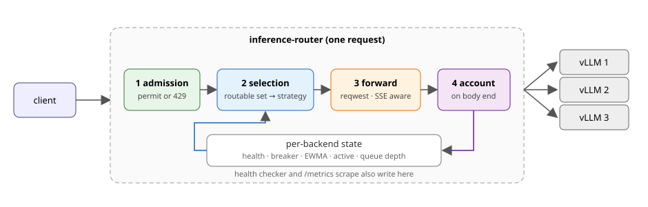

# Distributed Inference Router

A request router for [vLLM](https://github.com/vllm-project/vllm) replicas, written in Rust. It speaks the OpenAI-compatible API, picks a replica per request using one of five strategies, and keeps serving when replicas fail or saturate. Every feature listed below is covered by a test in `router-core/` or a row in the benchmark table, and the table is generated by a script in this repo.



## What it does

| Feature | Where | Verified by |
|---|---|---|
| Round-robin, weighted by config | `routing/round_robin.rs` | `weights_change_the_share`, e2e `weighted_round_robin_follows_config` |
| Least connections (router-side count) | `routing/least_connections.rs` | `picks_backend_with_fewest_connections` |
| Least load (router count + replica's own queue depth from `/metrics`) | `routing/least_load.rs` | e2e `least_load_avoids_backend_with_a_deep_queue` |
| Latency-aware weighted random (weight / EWMA time-to-first-byte) | `routing/latency_aware.rs` | `shares_follow_inverse_latency`, benchmark row `baseline / latency_aware` |
| Prefix-cache affinity via a consistent-hash ring (128 vnodes) | `routing/ring.rs`, `routing/prefix_cache.rs` | `removing_one_of_ten_backends_moves_at_most_15_percent_of_keys`, e2e `prefix_cache_keeps_locality_across_a_backend_loss` |
| Circuit breaker: sliding 1 s buckets, single half-open probe | `circuit_breaker.rs` | 14 unit tests, e2e `open_circuit_backend_is_skipped_not_503` |
| Backpressure: bounded in-flight, 429 beyond it; replicas over a queue-depth limit are skipped while others are under it | `backpressure.rs`, `backend.rs` | e2e `backpressure_returns_429_and_never_500`, `backend_over_queue_limit_is_not_routable` |
| Active health checks with hysteresis, concurrent across replicas | `health.rs` | `thresholds_add_hysteresis`, e2e `unhealthy_backend_is_skipped_after_health_check` |
| SSE streaming, accounted until the last chunk | `accounting.rs` | e2e `streaming_request_is_counted_until_the_stream_ends` |
| Prometheus metrics incl. scraped queue depth and KV usage | `metrics.rs` | e2e `metrics_endpoint_exposes_router_metrics` |

## Benchmark

Three mock vLLM replicas (40 / 60 / 80 ms base latency, 16 concurrent slots each) and the router, all in Docker Compose on a laptop; the load generator runs on the host. One repeat per row; rerun with `--repeats 3` and take the median for anything you want to cite.

<!-- BENCH:START -->
_Generated by `uv run python -m benchmarks.run_matrix` at commit `bebb53d` on the 3-mock compose stack (40/60/80 ms base latency)._

| scenario | strategy | ok | 429 | 5xx | p50 ms | p95 ms | p99 ms | req/s | backend share | prefix hit |
|---|---|---:|---:|---:|---:|---:|---:|---:|---|---:|
| baseline | direct_mock-2 | 2000 | 0 | 0 | 38.3 | 57.8 | 66.3 | 413 | - | 100% |
| baseline | latency_aware | 2000 | 0 | 0 | 36.5 | 76.5 | 94.4 | 1162 | mock-1 45%, mock-2 30%, mock-3 25% | 100% |
| baseline | least_connections | 2000 | 0 | 0 | 33.1 | 67.0 | 82.3 | 1315 | mock-1 46%, mock-2 31%, mock-3 23% | 100% |
| baseline | least_load | 2000 | 0 | 0 | 33.4 | 69.4 | 89.3 | 1290 | mock-1 45%, mock-2 31%, mock-3 24% | 100% |
| baseline | prefix_cache | 2000 | 0 | 0 | 59.3 | 103.4 | 113.3 | 841 | mock-1 40%, mock-2 49%, mock-3 11% | 100% |
| baseline | round_robin | 2000 | 0 | 0 | 40.0 | 102.5 | 117.5 | 954 | mock-1 33%, mock-2 33%, mock-3 33% | 98% |
| baseline | router_single_mock-2 | 2000 | 0 | 0 | 39.0 | 58.6 | 67.9 | 403 | mock-2 100% | 100% |
| failover | latency_aware | 3023 | 0 | 0 | 40.6 | 69.5 | 80.8 | 100 | mock-1 24%, mock-2 42%, mock-3 34% | 100% |
| failover | round_robin | 3022 | 0 | 0 | 42.9 | 71.5 | 83.7 | 100 | mock-1 18%, mock-2 41%, mock-3 41% | 99% |
| prefix_locality | prefix_cache | 2000 | 0 | 0 | 38.9 | 117.5 | 133.8 | 877 | mock-1 37%, mock-2 28%, mock-3 35% | 97% |
| prefix_locality | round_robin | 2000 | 0 | 0 | 53.4 | 145.7 | 168.0 | 714 | mock-1 33%, mock-2 33%, mock-3 33% | 47% |
| saturation | least_connections | 672 | 4328 | 0 | 94.8 | 205.1 | 239.4 | 1021 | mock-1 44%, mock-2 31%, mock-3 25% | 100% |
<!-- BENCH:END -->

How to read it: the table has 12 rows (7 baseline, 2 failover, 2 prefix_locality, 1 saturation).

- `baseline`: 2 000 requests at 50 concurrent. The two single-backend rows measure router overhead at equal concurrency (16): `direct_mock-2` sends the load straight to the 60 ms replica, `router_single_mock-2` sends it through the router configured with that one replica; the p50 difference is the router's cost (well under 1 ms here, which is inside the run-to-run noise of a single repeat, so read it as "not measurable at this load"). The multi-backend rows are not comparable to those two because they spread the load. `latency_aware` sends more traffic to the 40 ms replica and lowers p95 against `round_robin`. Absolute latencies sit below the replicas' base latency because the mock answers repeated prompts 40 % faster (its prefix cache), like a real vLLM with prefix caching on.
- `prefix_locality`: 10 system-prompt variants × 10 user prompts against replicas with a 48-entry prefix cache. The `prefix hit` column is the replicas' cache hit rate during the run, measured from their own counters: high with `prefix_cache`, around 50 % with `round_robin`, and the hit-dependent latency shows up in the p50 column.
- `failover`: replica 1 is marked unhealthy at t = 5 s and restored at t = 20 s of a 30 s run. 5xx should be a handful at the kill moment, then zero.
- `saturation`: 500 concurrent against `max_in_flight: 100`; the 429 column is the router shedding load, the 5xx column must be 0.

Regenerate:

```bash
uv sync --all-extras
uv run python -m benchmarks.run_matrix            # ~10 min, needs Docker
uv run python -m benchmarks.analyze benchmarks/results/*_r0.json --markdown --update-readme README.md
```

## Quick start

```bash
docker compose -f deploy/docker-compose.mock.yml up --build
# router :8080, mocks :8001-8003, Prometheus :9090, Grafana :3000 (admin/admin)

curl http://localhost:8080/v1/chat/completions \
  -H "Content-Type: application/json" \
  -d '{"model": "mock-model", "messages": [{"role": "user", "content": "Hello!"}], "max_tokens": 50}' -i
# x-router-backend: http://mock-2:8000
```

Configuration lives in one YAML file; every key is read by the router and unknown keys are rejected at startup. See [`config.example.yaml`](config.example.yaml).

```yaml
routing:
  strategy: latency_aware          # round_robin | least_connections | least_load | latency_aware | prefix_cache
  latency_aware: { alpha: 0.3 }    # EWMA smoothing
  prefix_cache: { prefix_token_count: 256 }
backends:
  - { url: "http://vllm-1:8000", weight: 1 }
circuit_breaker: { failure_rate_threshold: 0.5, min_requests: 5, window_secs: 60, open_duration_secs: 30 }
backpressure:    { max_in_flight: 1000, max_backend_queue_depth: 50 }
health_check:    { interval_secs: 5, unhealthy_threshold: 3, healthy_threshold: 2 }
```

## How a request flows

1. **Admission.** Take a permit from the in-flight budget or answer 429. The permit is released when the response body ends, not when headers are sent.
2. **Selection.** Build the routable set: healthy, breaker not open (or half-open with the probe free), scraped queue depth under `max_backend_queue_depth`. The queue limit is soft: if every live replica is over it, all of them stay routable and the in-flight budget sheds load instead. Hand the set to the strategy. If the strategy's pick refuses (half-open probe taken) drop it and ask again.
3. **Forward.** Buffer the body (10 MiB cap), strip hop-by-hop headers, send with reqwest. SSE responses are streamed through.
4. **Account.** A guard records the breaker verdict and metrics when it is dropped: immediately for buffered responses, at the last chunk for streams. The latency-aware EWMA is fed time-to-first-byte (headers received), so output length does not bias routing; the histogram records the full duration for every outcome. A client that disconnects mid-stream is recorded as `client_disconnect` and does not count against the replica; a backend that breaks a stream after headers is `stream_error` and does.

Breaker rules: failures are 5xx and transport errors (4xx is the client's fault). The failure rate is computed over the last `window_secs` in 1-second buckets. After `open_duration_secs` one probe request is let through; its result closes or re-opens the circuit.

## Metrics

| Metric | Type | Labels |
|---|---|---|
| `router_requests_total` | counter | strategy, backend, status (`200`, `502`, `stream_error`, `client_disconnect`, …) |
| `router_request_duration_seconds` | histogram | backend (full duration, every outcome) |
| `router_rejected_requests_total` | counter | reason: `backpressure`, `no_routable_backend` |
| `router_in_flight` | gauge | |
| `router_active_connections` | gauge | backend |
| `router_backend_health` | gauge | backend (0/1) |
| `router_circuit_breaker_state` | gauge | backend (0 closed, 1 half-open, 2 open) |
| `router_backend_queue_depth` | gauge | backend (scraped `vllm:num_requests_waiting`) |
| `router_backend_kv_cache_usage` | gauge | backend (scraped `vllm:kv_cache_usage_perc`, 0..1) |

The Grafana dashboard in `deploy/grafana/` reads only these.

## Development

```bash
cd router-core
cargo fmt --check && cargo clippy --all-targets -- -D warnings
cargo test            # 72 unit tests + 19 in-process e2e tests, no Docker, < 30 s
```

Python tooling (mock backend, load tester, docker-only tests):

```bash
uv sync --all-extras
uv run pytest -q                       # unit tests for the mock and the analyzer
uv run pytest -m docker -q             # needs the compose stack up
```

CI runs fmt, clippy, the Rust tests, ruff, the Python tests, and a compose smoke test on `main`.

## Running against real vLLM

`deploy/docker-compose.yml` starts three `vllm/vllm-openai` containers with `--enable-prefix-caching` and the router with `deploy/router-config-gpu.yaml`. It needs three NVIDIA GPUs and has not been benchmarked here; the numbers above come from the mock stack.

```bash
export MODEL_NAME=meta-llama/Llama-3.1-8B-Instruct
docker compose -f deploy/docker-compose.yml up --build
```

## Changes from v0.1 worth knowing

- `router_rejected_requests_total{reason=...}`: `no_healthy_backend` and `circuit_open` are replaced by a single `no_routable_backend` (a backend with an open circuit is simply not offered to the strategy any more).
- `router_requests_total{status=...}` gains the values `client_disconnect`, `stream_error` and `502`; the latency histogram records the full duration of every request, the EWMA only time-to-first-byte of successful ones.
- `routing.latency_aware.alpha` is new; unknown config keys are now rejected at startup.

## Known limitations

- Prefix hashing uses the first `prefix_token_count × 4` characters of the prompt, not real tokens, so prefix buckets are only approximately aligned with vLLM's 16-token blocks.
- With few distinct prefixes the hash ring cannot balance load: in the `baseline` row `prefix_cache` sends only ~10 % of 10 prompts' traffic to one replica. Affinity trades balance for cache hits; use it when the prompt population is large.
- The upstream client has a 300 s total timeout that also bounds streamed responses.
- No retries: a 502 from a dead replica is returned to the client; the breaker and health checker remove the replica for the next request.
- No TLS, auth or per-client rate limiting; put it behind a gateway for that.

## Layout

```
router-core/src/
  app.rs          build_app(config): pool, breakers, strategy, metrics, health task
  server.rs       routes + the 4-step handler
  proxy.rs        forward_request -> Forwarded {status, headers, body}
  accounting.rs   RequestAccounting guard, AccountedStream
  backend.rs      Backend (owns its CircuitBreaker), BackendPool::routable()
  backpressure.rs Permit
  circuit_breaker.rs
  health.rs       probes + /metrics scrape
  metrics.rs
  routing/        round_robin, least_connections, least_load, latency_aware, prefix_cache, ring
router-core/tests/   e2e.rs + support/ (in-process mock vLLM)
mock_backend/        Python mock vLLM for Docker (queue, decaying KV, prefix LRU)
benchmarks/          load_test.py, run_matrix.py, analyze.py
deploy/              compose files, Prometheus, Grafana
```
